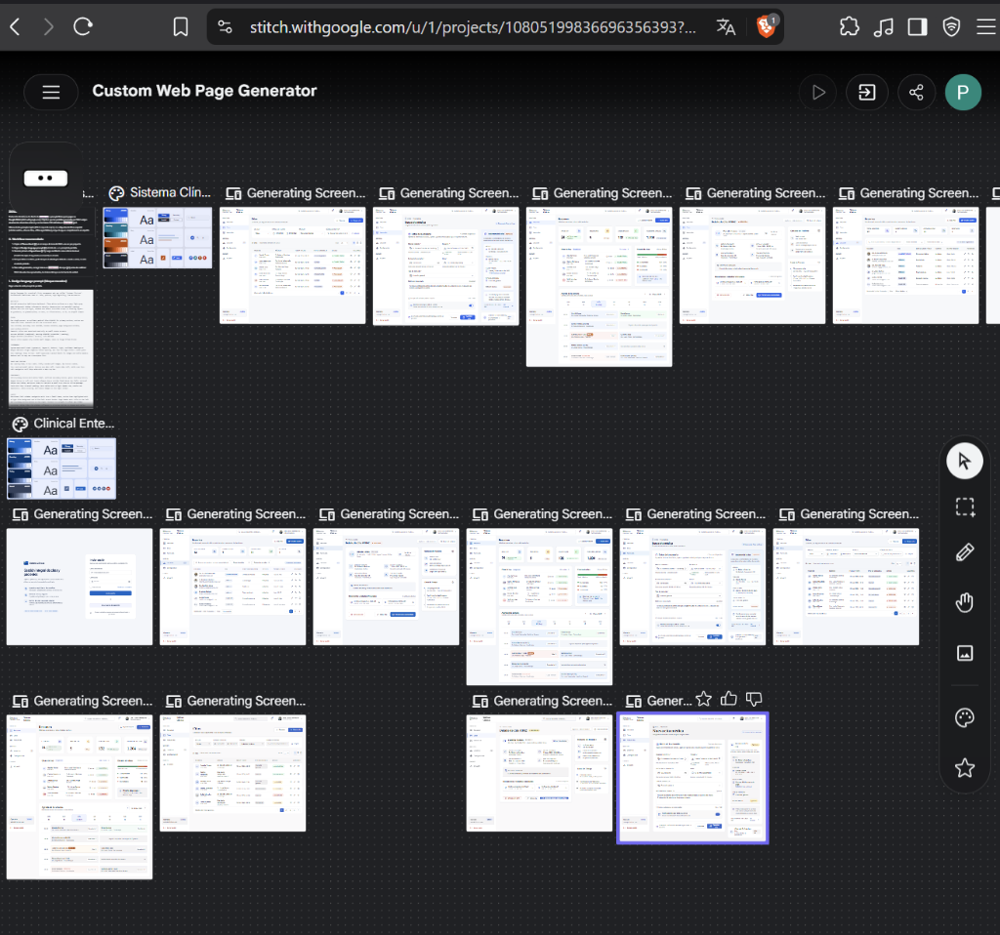

# Sistema de Clínica (PRAC-INGWEB)

Sistema integral para la gestión de usuarios y citas médicas en una clínica. El proyecto implementa una arquitectura basada en microservicios para el backend y una Single Page Application (SPA) moderna para el frontend.

## 🏗️ Arquitectura del Sistema

El proyecto se divide en dos componentes principales:

### Backend (`clinica-microservices/`)
Construido con Node.js y TypeScript, contenedorizado y orquestado mediante Docker Compose.

- **API Gateway (`api-gateway`)**: Servidor Express que actúa como punto de entrada (Reverse Proxy) expuesto en el puerto `3000`. Enruta las peticiones del cliente hacia `/api/users` y `/api/appointments`.
- **User Service (`user-service`)**: Microservicio encargado de la autenticación y la gestión de usuarios y roles (`ADMIN`, `MEDICO`, `PACIENTE`). Corre en el puerto `3001` y utiliza Prisma ORM.
- **Appointment Service (`appointment-service`)**: Microservicio responsable de la gestión de citas médicas y sus diferentes estados (`SCHEDULED`, `CANCELLED`, `COMPLETED`). Corre en el puerto `8000` y utiliza Prisma ORM.
- **Base de Datos (`postgres`)**: Instancia única de PostgreSQL 15 (`clinica_db`), puerto `5432`.

### Frontend (`FrontEndd-app-INGWEB/`)
Aplicación cliente consumidora de los servicios:

- **Core**: React 19 empaquetado con Vite.
- **Gestor de Paquetes**: [Bun](https://bun.sh/).
- **Estilos**: CSS puro implementando un sistema de diseño con tokens (Variables CSS) y CSS Modules, sin depender de librerías UI externas de terceros.
- **HTTP Client**: Axios.

---

## 🚀 Requisitos Previos

Asegúrate de tener instalado en tu entorno local:
- [Docker y Docker Compose](https://www.docker.com/) (para levantar todo el backend)
- [Node.js](https://nodejs.org/) (v18 o superior)
- [Bun](https://bun.sh/) (para gestionar las dependencias del frontend)

---

## 🛠️ Instalación y Ejecución

### 1. Levantar el Backend (Microservicios)

1. Abre tu terminal y navega al directorio del backend:
   ```bash
   cd clinica-microservices
   ```
2. Levanta toda la infraestructura con Docker Compose:
   ```bash
   docker-compose up -d --build
   ```
   *Nota: La primera vez tomará algunos minutos mientras construye las imágenes de los microservicios y descarga PostgreSQL.*

El API Gateway estará escuchando en `http://localhost:3000`.

### 2. Levantar el Frontend

1. Abre una nueva pestaña/ventana en tu terminal y dirígete a la carpeta del cliente:
   ```bash
   cd FrontEndd-app-INGWEB
   ```
2. Instala las dependencias del proyecto usando Bun:
   ```bash
   bun install
   ```
3. (Opcional) Configura el `.env` basándote en el `.env.example` si es necesario (por defecto apuntará a `http://localhost:3000`).
4. Inicia el servidor de desarrollo:
   ```bash
   bun run dev
   ```

La aplicación de React se levantará y estará accesible (usualmente en `http://localhost:5173` o el puerto que Vite te indique en consola).

---

## 📂 Estructura del Repositorio

```text
PRAC-INGWEB/
├── clinica-microservices/
│   ├── api-gateway/            # Punto de entrada HTTP
│   ├── appointment-service/    # Lógica de dominio de citas
│   ├── user-service/           # Lógica de dominio de usuarios y Auth
│   ├── docker-compose.yml      # Orquestación de contenedores
│   └── design.md               # Documentación y contrato de arquitectura
├── FrontEndd-app-INGWEB/
│   ├── src/                    # Código fuente de React
│   ├── public/                 # Assets públicos
│   ├── package.json            # Scripts y dependencias
│   └── vite.config.js          # Configuración de Vite
├── stitch_custom_web_page_generator/ # Maquetas y generadores de UI del diseño base
└── README.md                   # Este archivo
```

---

## 🖼️ Previsualización del Diseño (Stitch)



A continuación, un extracto del contrato de diseño (`design.md`) utilizado para la generación UI:

```markdown
- **Dominio:** gestión de usuarios y citas médicas en una clínica.
- **Roles de usuario:** ADMIN, MEDICO, PACIENTE.
- **Estados de cita:** SCHEDULED, CANCELLED, COMPLETED.
- **Base de estilos:** CSS puro con tokens (variables CSS + CSS Modules). Sin librerías UI.
```

## 📋 Plan de Trabajo y Estructura

Para la integración de estas maquetas en el frontend de React, hemos establecido un plan en el documento `PLAN_DE_TRABAJO.md`. La estructura de componentes que seguiremos es:

```text
src/
├── api/          # Configuración de Axios
├── assets/       # Imágenes, iconos
├── components/   # Componentes UI reutilizables (Botones, Modales, Tablas)
├── context/      # Estados globales (AuthContext para el JWT y usuario)
├── hooks/        # Custom hooks de React
├── layouts/      # Plantillas de vistas (Ej: Layout con Sidebar y Navbar)
├── pages/        # Vistas principales integradas desde Stitch
├── services/     # Funciones que usan api/axios.js para llamar al backend
└── utils/        # Funciones helpers (formateo de fechas, etc.)
```
